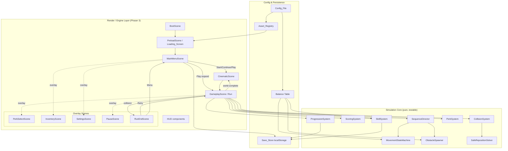
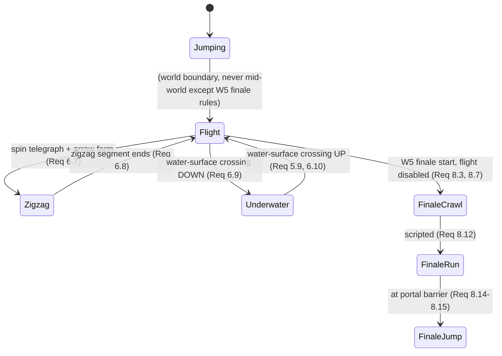

# Design Document

## Overview

KINO is a browser-based 2D side-scrolling arcade endless-runner built on **Phaser 3**. The player guides Kino — a ghost/bird hatchling — across five AWS-themed worlds, each introducing a movement ability (Jumping, Flight, Zigzag, Underwater_Buoyancy), culminating in a scripted World 5 finale that combines them all. The story loops generationally, granting permanent cosmetic rewards.

This design turns the 46 requirements into an implementation-guiding technical plan. It is organized around four pillars:

1. **A Phaser scene graph** that cleanly separates boot/preload, menu, cinematics, gameplay, and overlays (satisfies Req 20, 21, 37).
2. **An asset-decoupled, config-driven core** where all art/audio/text/palettes flow through a user-editable `Config_File` into an internal `Asset_Registry`, with placeholder fallback everywhere (Req 24, 33, 38).
3. **A deterministic gameplay simulation** — the fixed-Kino scrolling model (Req 45), a single-active Movement_Mode state machine (Req 2–6, 8), exactly-once scoring (Req 9), and fair collision/safe-reposition logic (Req 41, 44).
4. **A durable persistence layer** over `localStorage` that cleanly distinguishes permanent progress from per-generation run state (Req 22, 28, 40).

### Key design decisions and rationale

| Decision | Rationale | Requirements |
|---|---|---|
| Phaser 3 with the Scene system | Mature HTML5 2D engine; scene lifecycle maps directly to the required state separation; Scale Manager handles adaptive layout | 26.1, 26.10–26.12 |
| **Custom deterministic movement/collision logic** layered over Phaser (not raw Arcade Physics for scoring-critical paths) | Scoring, exactly-once crossing detection, and safe-reposition demand reproducible, frame-rate-independent results that property tests can verify. Arcade Physics is used for visual smoothing/particles only | 9.x, 41.x, 44.x |
| Fixed-Kino + scrolling world (`Scrolling_Model`) | Required core model; makes forward progress identical across all modes and simplifies spawn math | 45.x, 46.x |
| Config_File → Asset_Registry indirection | Lets a non-programmer swap art/text/palettes; placeholder fallback keeps the game always runnable | 24.x, 33.x, 37.5, 38.x |
| Pure "simulation core" modules independent of Phaser rendering | Enables property-based testing of invariants without a browser/canvas | 9, 26.6, 44 |
| `Save_Store` schema versioned and validated on read | Graceful handling of corrupt/legacy saves without clobbering recoverable data | 22.x, 40.x |

### Target platform

Modern desktop/tablet browsers, squarish desktop aspect ratio, 60 fps target with graceful degradation (Req 26.9–26.12).

---

## Architecture

### High-level layering

The codebase is split into a **render/engine layer** (Phaser scenes, sprites, input, audio) and a **simulation core** (pure TypeScript/JS modules with no Phaser dependency). The simulation core owns every rule that must be correct and testable: movement state, scoring, collision resolution, safe-reposition, progression, and persistence serialization. Scenes drive the core each frame with a fixed timestep and render its output.



### Scene breakdown and responsibilities

| Scene | Responsibility | Key requirements |
|---|---|---|
| **BootScene** | Read `Config_File`, build `Asset_Registry`, load `Save_Store` (or create `First_Launch_State`), register scale/input managers | 33, 24.8, 40 |
| **PreloadScene** (`Loading_Screen`) | Preload all registered assets with a progress bar; per-asset placeholder fallback on load failure; enable menu entry only when complete | 37.1–37.5 |
| **MainMenuScene** | Treasure-map vertical scroll + lock-in, Kino on menu, generation pill, Stats/Settings/Cosmetics/Skills controls, bottom primary button (Start/Continue), Play control, endless triangles | 20, 23.4, 28.4, 31, 32, 34 |
| **CinematicScene** | Opening egg-descent, mentor cutscenes, evolution, world-completion, final cinematic, credits/bloopers; all skippable | 21, 29, 42 |
| **GameplayScene** (Run) | Drives the simulation core each fixed step, renders Kino/obstacles/parallax, HUD, scrolling model, transitions | 1–9, 44, 45, 46 |
| **PerkSelectScene** (overlay) | Two perk choices + optional center cosmetic at obstacle 20 & 40; pauses run beneath | 10, 11 |
| **InventoryScene** (overlay) | Tabbed Cosmetics/Skills grid, preview above Kino, equip jiggle | 12, 19, 20.42–20.47, 43 |
| **SettingsScene** (overlay) | Volume, rebinding, reset-save confirm | 20.48–20.51, 25.7 |
| **PauseScene** (overlay) | Freezes run & all timers; resume continues | 7.9–7.13 |
| **RunEndScene** | Score, time, high score, obstacles cleared, Retry/Menu | 28, 39 |

Overlays are launched with Phaser's parallel-scene mechanism (`scene.launch`) and pause the scene beneath so the gameplay simulation genuinely freezes (critical for the pause-freezes-timers invariant, Req 7.10–7.12).

### The fixed-timestep driver

`GameplayScene.update(time, delta)` accumulates `delta` and advances the simulation core in fixed steps (default `1/120 s`), then renders an interpolated frame. A fixed step makes crossing detection, timers, and reposition reproducible and decouples correctness from frame rate (supports Req 9, 26.9). Time Slow (Req 16) scales the step rate uniformly for both Kino and obstacles; Pause (Req 7.10) halts accumulation entirely.

### Play-button expand transition (Req 20.36–20.38, 20.12)

1. Play pressed → the Play button grows as an upward color fill until it covers the screen (`20.36`).
2. At full cover → `MainMenuScene` hands off to `GameplayScene`; HUD and world background fade in (`20.37`).
3. Kino glides from its menu position to the fixed run start position on the left and stabilizes (`20.38`, `20.12`). Kino is a persistent sprite object passed between scenes so it is literally "kept placed."

### Fixed-Kino scrolling run (Req 45, 46)

Kino holds a constant `screenX`. The world is a set of parallax background layers plus an obstacle field that translate leftward at the current `scrollSpeed`. Vertical/diagonal motion is Kino's only normal movement. Dash (Req 15/45.3) and the World 5 finale (Req 8.8–8.12) are the sole sanctioned exceptions that move Kino horizontally.

---

## Components and Interfaces

All core interfaces below are Phaser-independent. Types are shown in TypeScript-style signatures for clarity; implementation language follows the project setup.

### Config & Asset layer

```
ConfigFile                      // the single user-editable source (Req 33)
  loadAndValidate(): ConfigFile
AssetRegistry                   // internal mapping consumed by gameplay (Req 24.4, 24.8)
  fromConfig(cfg): AssetRegistry
  resolve(key): ResolvedAsset   // returns configured asset OR placeholder (Req 24.10, 33.7, 37.5)
  hasReal(key): boolean
BalanceTable                    // tunable numeric values pulled from config (Req 26.8, 41, 11.5, 15.2, 16.2)
```

`AssetRegistry.resolve` is the single choke point for placeholder fallback: if the configured path is missing/empty or failed to load, it returns the registered placeholder generator (a geometric shape / tone) for that key. Gameplay never references raw paths.

### Simulation core

```
SequenceDirector                 // composes a World from Sequences (Req 4.4-4.7, 5.5-5.7, 8.2-8.6)
  currentSequence(): Sequence
  tick(dt): TransitionEvent | null
  requestTransition(kind)        // environment-forced only (Req 6.1, 6.2)

MovementStateMachine             // exactly one active mode (Req 2-6)
  active(): MovementMode
  canTransition(to, ctx): bool   // gates water-surface crossing (Req 5.9-5.10, 6.9-6.11)
  applyPrimary(ctx)              // mode-specific primary action (Req 1.2, 2.1, 3.1, 4.1, 5.2)
  step(dt): KinoKinematics       // mode-specific physics (gravity/impulse/buoyancy/diagonal)

ObstacleSpawner                  // procedural, per-world, mode-aware, endless-capable (Req 23, 46)
  spawnWindow(scrollX, world, mode, difficulty): Obstacle[]
  allowedModes(world, mode): Set // ability restriction (Req 23.7-23.8)

ScoringSystem                    // exactly-once, attributed, multiplier-at-credit (Req 9)
  credit(obstacleId, mode): ScoringEvent | Invalid
  current(): number
  activeMultiplier(): number

CollisionSystem                  // consistent hitboxes across modes (Req 26.7, 41)
  check(kino, obstacles, mode): CollisionResult
  hitbox(mode): Rect             // per-mode fair hitbox (Req 41.1-41.2)

SafeRepositionSolver             // THE hard problem (Req 14, 18, 44)
  reposition(mode, kino, field): SafePlacement

SkillSystem                      // active skills, timers freeze on pause (Req 12-18, 35)
PerkSystem                       // two-choice drops, retention model (Req 10, 11)
ProgressionSystem                // unlocks, generations, endless (Req 7, 22, 23, 36)
SaveStore                        // localStorage serialize/deserialize (Req 22, 28, 40)
```

### Rendering components (Phaser)

- **KinoRenderer** — draws base Kino independently (Req 19.1) plus positioned cosmetic layers per Animation_Frame/mode (Req 19.2–19.3); cosmetic layers are render-only and carry no collision geometry (Req 19.6); hides cosmetics during transitions (Req 6.5).
- **ParallaxBackground** — multi-layer per-world scroll at different speeds (Req 30.3).
- **ObstacleView / object pool** — recycles sprites for obstacles and particles (Req 26.3, 26.9).
- **HUD** — score top (Req 20.39), equipped skill bottom-right with cooldown/duration (Req 12.3, 12.7, 35.8), menu control (Req 20.40), multiplier indicator (Req 17.2).
- **TransitionOverlay** — spin cycle (spin-1/spin-2), surface-crossing pane, telegraph markers; rendering priority over character layers (Req 6.6).

---

## Data Models

### Config_File schema

The `Config_File` is the single user-facing editable layer (Req 33.1–33.8). It is a structured object (one module or a small set) with the following concrete shape. Every key required by the requirements is present; any missing/empty asset path triggers placeholder fallback (Req 33.7, 24.10).

```jsonc
{
  "names": {
    "baseCharacterName": "Kino",                 // Req 29.12, 32.2
    "generationalScheme": {                      // Req 32.1-32.2
      "format": "{base} {roman} {suffix}",       // -> "Kino III Junior"
      "juniorSuffix": "Junior",
      "seniorSuffix": "Senior",
      "startIteration": 1
    },
    "mentors": {                                 // Req 29.2-29.6, 29.12
      "world1": "Officer Kino-Route-53",
      "world2": "Engineer Kino-EC2",
      "world3": "Archivist Kino",
      "world4": "Storage Keeper Kino",
      "world5": "Commander Kino-IAM"
    },
    "worlds": {                                  // Req 27.1-27.5 (display names)
      "world1": "Desert", "world2": "Foundry", "world3": "Memory Jungle",
      "world4": "Ice & Underwater", "world5": "Security Citadel"
    }
  },

  "labels": {                                    // Req 20.13, 33.3
    "startStory": "Start Story",
    "continueStory": "Continue Story",
    "permissionGag": "aws:button:not-allowed",   // Req 21.12
    "play": "Play", "retry": "Retry", "menu": "Menu",
    "newWorldUnlocked": "New world unlocked!",
    "endlessStarting": "Endless mode starting...",
    "endlessConfirm": "Endless Mode is outside story progression."
  },

  "animationFrames": {                           // Req 30.7-30.12, 33.9-33.14
    "jumping":  { "run-step-right": "", "run-step-left": "",
                  "jump-go-up": "", "jump-apex": "", "jump-go-down": "" },
    "flight":   { "fly-up": "", "fly-apex": "", "fly-down": "" },
    // Underwater_Buoyancy REUSES flight frames (Req 30.9, 33.11) - no separate keys
    "zigzag":   { "zigzag-up": "", "zigzag-down": "" },
    "spin":     { "spin-1": "", "spin-2": "" },        // transition spin (Req 30.11)
    "crawl":    { "crawl-step-right": "", "crawl-step-left": "" } // W5 finale (Req 30.12)
  },
  "menuEquipJiggle": "",                          // "menu-equip-jiggle" key (Req 33.15-33.16, 43.4-43.5)

  "obstacleCategories": {                         // named keys, consistent convention (Req 24.11, 38.1-38.2)
    "world1_ground_obstacle": "",
    "world2_pillar_top": "", "world2_pillar_bottom": "",
    "world3_zigzag_wall": "",
    "ceiling_underwater_obstacle": "",            // Req 5.11, 38.2
    "floor_underwater_obstacle": "",              // Req 5.11, 38.2
    "world5_barrier": ""
    // ...one key per obstacle type across all worlds
  },

  "colorPalettes": {                              // element-level treatment, not bg-only (Req 27.13-27.14, 33.4-33.5, 38.3)
    "world1": { "background": "#E8A33D", "obstacles": "#C77D2E", "kino": "#F5E6C8",
                "overlays": [] },
    "world2": { "background": "#B5451F", "obstacles": "#6E6E6E", "kino": "#F0C27B",
                "overlays": [{ "name": "lavaGlow", "target": "background", "tint": "#FF6A00", "alpha": 0.25 }] },
    "world3": { "background": "#123A5E", "obstacles": "#2E7D4F", "kino": "#CFEccc", "overlays": [] },
    "world4": { "background": "#7FD3E0", "obstacles": "#D7F2F7", "kino": "#EAFBFF",
                "overlays": [{ "name": "underwaterBlue", "target": "obstacles+kino",   // atomic (Req 38.4)
                               "tint": "#1E6FB0", "alpha": 0.35, "appliesWhen": "underwaterSequence" }] },
    "world5": { "background": "#2B2F36", "obstacles": "#4A4F57", "kino": "#E6E6E6",
                "overlays": [{ "name": "redAlert", "target": "background", "tint": "#C81E1E", "alpha": 0.20 }] }
  },

  "mentorImages": {                               // Req 33.1
    "world1": "", "world2": "", "world3": "", "world4": "", "world5": ""
  },
  "mentorDialogue": {                             // Req 42.1-42.6 (alternating speaker lines)
    "world1": [ { "speaker": "mentor", "text": "..." }, { "speaker": "kino", "text": "..." } ]
    // ...per world
  },
  "mentorSymbols": { "world1": "Route53", "world2": "EC2", "world3": "Databases",
                     "world4": "Glacier", "world5": "IAM" },   // Req 29.1-29.6

  "worldBackgrounds": { "world1": "", "...": "" },              // Req 33.1
  "worldMusic":       { "world1": "", "...": "" },              // Req 25.5
  "audio": {                                                     // Req 25.1-25.6, 24.7
    "jump": "assets/jump.wav", "fly": "", "zigzag": "", "underwater": "",
    "evolution": "", "collision": "assets/game_over.wav", "ui": "",
    "mentorReaction": ""
  },
  "starterAssets": {                               // Req 24.7 - existing assets wired in
    "kinoSprite": "assets/ghosty.png", "exampleUi": "img/example-ui.png"
  },

  "cinematics": {                                  // Req 21.9 credits/bloopers slot
    "creditsSlots": [], "blooperSlots": []
  },

  "evolutionStyle": "electric-zap-glow-burst",     // Req 29.9

  "skillUnlockSchedule": {                          // Req 36.1-36.3, editable (Skill_Unlock_Schedule)
    // fixed list order matched to world order; gen1->6th, gen2->7th
    "world1First": "secondChance",
    "world2First": "timeErase",
    "world3First": "dash",
    "world4First": "timeSlow",
    "world5First": "scoreMultiplier",
    "generation1Complete": "ultraInstinct",
    "generation2Complete": "nuke"
  },
  "skillRarity": {                                  // display/flavor only (Req 36.4-36.6)
    "secondChance": "common", "timeErase": "rare", "dash": "common",
    "timeSlow": "uncommon", "scoreMultiplier": "rare",
    "ultraInstinct": "legendary", "nuke": "legendary"
  },
  "cosmeticRarityColors": { "common": "#B0B0B0", "uncommon": "#49A94A",
                            "rare": "#2E7CD6", "legendary": "#C9931F" },

  "balance": { /* see Balance Table below */ }
}
```

**Config_File → Asset_Registry population & fallback (Req 24.8, 24.10, 33.6–33.8, 37.5):**
At boot, `AssetRegistry.fromConfig(cfg)` walks every asset-bearing key and records `{ key, configuredPath, placeholderFactory }`. During `PreloadScene`, each `configuredPath` that is non-empty is queued in the Phaser loader. On load complete or load **error**, the registry marks the key as `real` or `placeholder`. `resolve(key)` returns the real texture if available, otherwise invokes the placeholder factory (a geometric shape tinted from the world palette). Gameplay logic calls only `resolve(key)`, so collision/physics/scoring are identical for placeholder vs final art (Req 24.3, 24.6, 30.6).

### Balance Table (tunable — sensible starting defaults)

All values are read from `Config_File.balance` (Req 26.8, 11.5, 15.2, 16.2, 41.1–41.2). **These are starting defaults, clearly marked tunable**; many were deferred during requirements and are set here to reasonable values. The defaults below are grouped by system — `movement` (`jump.*`, `flight.*`, `underwater.*`, `zigzag.*`), `difficulty` (`scrollSpeed.*`, `obstacleDensity.*`, `worldUnlockThreshold`, `perkObstacleMilestones`), `skills` (`skill.*`), `perks` (`perk.*`, `cosmetic.*`), `hitboxes` (`hitbox.scale.*`), and `transitions` (`telegraph.*`) — matching the labeled sub-sections of the editable config module described under **Tuning ergonomics**.

| Key | Default | Unit | Req |
|---|---|---|---|
| `scrollSpeed.base` | 220 | px/s | 45, 7.6 |
| `scrollSpeed.rampPerObstacle` | 2.5 | px/s per cleared obstacle | 7.6, 23.3 |
| `scrollSpeed.maxMultiplier` | 2.2 | × base | 7.6 |
| `obstacleDensity.baseGapPx` | 360 | px between units | 46, 23.3 |
| `obstacleDensity.minGapPx` | 210 | px (floor as difficulty ramps) | 23.3 |
| `jump.impulse` | 520 | px/s up | 2.1 |
| `jump.gravity` | 1600 | px/s² | 2.2 |
| `flight.impulse` | 300 | px/s up | 3.1 |
| `flight.gravity` | 900 | px/s² | 3.2 |
| `underwater.impulse` | 300 | px/s down | 5.2 |
| `underwater.buoyancy` | 900 | px/s² up | 5.1 |
| `zigzag.angleDeg` | 30 | degrees | 4.1 |
| `zigzag.speed` | 260 | px/s along diagonal | 4.8 |
| `telegraph.leadPx` | 500 | px before a transition | 6.3 |
| `hitbox.scale.default` | 0.70 | × sprite | 41.1 |
| `hitbox.scale.jumping` | 0.72 | × sprite | 41.2 |
| `hitbox.scale.flight` | 0.68 | × sprite | 41.2 |
| `hitbox.scale.zigzag` | 0.75 | × sprite | 41.2 |
| `hitbox.scale.underwater` | 0.68 | × sprite | 41.2 |
| `perk.speedBoostPct` | +12 | % | 11.2 |
| `perk.cooldownReductionPct` | -20 | % | 11.1 |
| `cosmetic.dropProbability` | 0.35 | probability at a perk slot | 11.5, 10.8 |
| `skill.secondChance.windowS` | 3 | s | 13.1 |
| `skill.timeErase.windowS` | 4 | s | 14.1 |
| `skill.dash.distancePx` | 260 | px | 15.2 |
| `skill.dash.durationS` | 0.25 | s | 15.2 |
| `skill.timeSlow.factor` | 0.5 | × speed | 16.2 |
| `skill.timeSlow.durationS` | 5 | s | 16.2 |
| `skill.scoreMultiplier.factor` | 2 | × | 17.1 |
| `skill.scoreMultiplier.durationS` | 10 | s | 17.1 |
| `skill.ultraInstinct.durationS` | 10 | s | 18.1 |
| `skill.cooldownS.default` | 12 | s | 12.3 |
| `worldUnlockThreshold` | 50 | points | 7.1 |
| `perkObstacleMilestones` | [20, 40] | obstacle counts | 10.1–10.2 |

### Tuning ergonomics

To keep constants easy to change (Req 33, 26.8), **all tuning values live in exactly one place**: the `Config_File.balance` block. This is a plain, human-editable config module (e.g. `config.js` / `config.ts`, or a `config.json`) kept **separate from gameplay logic**, so tuning never means hunting through behavior code.

- **One source of truth.** The `balance` block is the only home for tunable constants. Gameplay modules receive these values via the `BalanceTable` at load (as shown above) and **never hardcode constants**, so the config module is authoritative (Req 33.1, 26.8).
- **Organized by system.** The `balance` block SHALL be split into clearly labeled sub-sections so any value is easy to locate: `movement` (per-mode physics: `jump`, `flight`, `underwater`, `zigzag`), `difficulty` (`scrollSpeed`, `obstacleDensity` gaps, `worldUnlockThreshold` and milestone/ramp thresholds), `skills` (per-skill cooldown / duration / magnitude), `perks` (boost and cooldown percentages, cosmetic drop probability, rarity), `hitboxes` (per-mode `scale`), and `transitions` (telegraph lead). These map directly to the grouping called out in the Balance Table intro.
- **Self-documenting values.** Each value SHALL carry an inline comment documenting its **unit**, its **default**, and a **sensible min/max range**, so an edit stays within safe bounds without reading gameplay code. For example:

  ```jsonc
  balance: {
    movement: {
      jump: {
        impulse: 520,   // px/s up — default 520, sensible 350–700
        gravity: 1600   // px/s²  — default 1600, sensible 1000–2200
      }
      // ...
    },
    difficulty: {
      scrollSpeed: {
        base: 220,              // px/s — default 220, sensible 140–320
        rampPerObstacle: 2.5,   // px/s per cleared obstacle — default 2.5, sensible 0–6
        maxMultiplier: 2.2      // × base — default 2.2, sensible 1.2–3.0
      }
      // ...
    }
    // skills, perks, hitboxes, transitions ...
  }
  ```

- **Editing workflow.** A developer changes a value in the config module and **reloads the page** to see the effect — no rebuild step beyond the normal dev serve, and **no change to gameplay logic** is required (Req 33.5: "use the new value without changes to gameplay logic").
- **Out of scope (future-friendly).** Because gameplay reads only through the `BalanceTable`, a dev-only live-tuning panel or hot-reload could later layer on **without changing this structure**. That is explicitly out of scope for now.

### Save_Store schema (Req 22, 28, 40)

Stored under a single `localStorage` key `kino.save.v1` as JSON. A `schemaVersion` enables migration; on unreadable/invalid data the loader returns `First_Launch_State` **without overwriting** the raw stored string until a successful write occurs (so a recoverable/legacy blob is not clobbered — error handling below).

```jsonc
{
  "schemaVersion": 1,
  "generation": { "iteration": 1, "suffix": "Junior" },   // Req 32, 40.1
  "unlockedSkills": [],                                    // permanent (Req 22.1, 12.6, 36.3)
  "unlockedCosmetics": [],                                 // permanent incl. random drops (Req 22.2, 10.11, 19.5)
  "equippedSkill": null,
  "equippedCosmetic": null,
  "controlBindings": {                                     // Req 1.6-1.9, 22.7
    "primary": ["SPACE", "MOUSE_LEFT"],
    "skill":   ["Q", "MOUSE_RIGHT"]
  },
  "settings": { "volume": 0.8, "muted": false },           // Req 25.8, 20.49
  "worlds": {                                              // discovery / clear state (Req 20.3-20.4, 27.15-27.16)
    "world1": { "discovered": true, "storyCleared": false, "leftBehind": false },
    "world2": { "discovered": false, "storyCleared": false, "leftBehind": false }
    // ...
  },
  "highScores": {                                          // per world & mode, separate (Req 28.1-28.2)
    "story":   { "world1": 0, "world2": 0, "...": 0 },
    "endless": { "world1": 0, "world2": 0, "...": 0 }
  },
  "highScoreHistoryByGeneration": {                        // this-gen vs past-gen (Req 31.2)
    "1": { "story": { "world1": 0 } }
  },
  "generationCosmeticsAwarded": []                         // Req 22.4
}
```

**Persisted (permanent):** unlocked skills, unlocked cosmetics, equipped selections, control bindings, settings/volume, generation name, world discovery/clear/left-behind state, per-world/per-mode high scores, cross-generation high-score history (Req 22.1–22.2, 22.6–22.7, 25.8, 28, 31.2).

**Reset each new generation (NOT persisted as run state):** learned movement abilities, perks, temporary run bonuses, current score, current run progression (Req 22.3, 10.6, 11.4). Abilities are re-learned via mentor/evolution each generation (Req 29.7–29.8) and are never restored from the save (Req 22.7).

### Runtime entities

```
MovementMode = "jumping" | "flight" | "zigzag" | "underwater"

MovementState {                 // Req 2-6
  mode: MovementMode
  y: number; vy: number
  facing / diagonalDir: "up" | "down"   // zigzag (Req 4.1, 4.8)
  isTransitioning: boolean              // skills off, cosmetics hidden (Req 6.4-6.5)
}

Obstacle {                       // Req: Obstacle / Obstacle_Unit glossary, 9.6
  id: string                     // stable unique id -> exactly-once scoring key
  category: string               // Obstacle_Category key (Req 24.11, 38.1)
  mode: MovementMode             // which mode it belongs to
  bounds: Rect[]                 // may be multiple visual elements, one scoring unit
  scoringLineX: number           // the x at which clearing credits the unit
  scored: boolean                // guard against double count (Req 9.1, 35.4)
}

ScoringEvent {                   // Req 9
  obstacleId: string
  baseValue: 1
  mode: MovementMode             // attributed at moment of clearing (Req 9.2)
  multiplierAtCredit: number     // snapshot at credit time (Req 9.4, 17.1)
  creditedValue: number          // baseValue * multiplierAtCredit
}

Skill {                          // Req 12, 36 - separate from Perk (Req 11.3)
  id: SkillId
  rarity: string                 // flavor only (Req 36.4-36.5)
  cooldownS: number; cooldownRemaining: number
  effectDurationS: number; effectRemaining: number
  state: "ready" | "active" | "cooldown"
}

Perk {                           // Req 10, 11 - separate from Skill
  id: "speedBoost" | "cooldownReduction" | ...
  magnitude: number              // configurable % (Req 11.1-11.2, 11.5)
}

WorldDefinition {                // Req 27, 46
  id: 1..5
  theme / serviceFamily / mentorKey / paletteKey: string
  sequencePlan: SequenceSpec[]   // composition per world (Req 4.4, 5.5, 8.2-8.6)
  endlessEnabled: boolean        // false for W5 (Req 23.2)
  allowedEndlessModes: MovementMode[]  // abilities up to & incl. this world (Req 23.7-23.8)
}

Sequence {                       // Req: Sequence glossary, 4.5-4.7
  mode: MovementMode
  isFinale: boolean              // W5 scripted finale (Req 8.8)
  loops: boolean                 // W3 alternation (Req 4.7)
}
```


---

## Movement & Sequence System

### Movement_Mode state machine (Req 2–6, 8.4–8.6)

`MovementStateMachine` guarantees **exactly one active mode per Sequence**. The machine is the only authority on mode; the player can never select a mode (Req 6.1–6.2). Transitions are requested exclusively by the `SequenceDirector` (environment-driven) or by the water-surface crossing event.



Invariant enforcement (Req 4.5–4.6, 5.6–5.7, 8.4–8.5): `requestTransition(to)` first sets `active = to`; any lingering mode flags are cleared in the same atomic step, so no two modes are ever simultaneously active. A test hook `activeModes()` returns a set that must always have size 1 during a Sequence.

### Telegraphed, environment-forced transitions (Req 6.3–6.11)

The `SequenceDirector` tracks the scroll distance to the next scheduled Sequence boundary. When the distance drops below `balance.telegraph.leadPx`, it emits a `TransitionTelegraph` the `GameplayScene` renders (spin cue, surface approach, color shift). During a transition: skills are disabled (Req 6.4, 12.4, 35.6), cosmetic layers hidden (Req 6.5), and the transition animation gets render priority (Req 6.6).

**Water-surface gating (Req 5.9–5.10, 6.9–6.11):** Underwater↔Flight transitions are the one case driven by a physical event rather than scroll distance. `canTransition(flight↔underwater, ctx)` returns true only when `ctx.waterSurfaceCrossed` is set that step. If a transition between these two modes is requested without the crossing event, the machine keeps the current mode and performs no transition. The `Transition_Pane` sprite marks the surface (Req 5.13, 46.4).

**Spin/arrow zigzag transition (Req 6.7–6.8):** Flight→Zigzag plays the `spin-1`/`spin-2` cycle and swaps Kino to the pointed arrow form; when the zigzag segment ends, the reverse spin returns Kino to flight form.

### Per-mode physics (all values from Balance Table)

| Mode | Primary action | Between actions | Req |
|---|---|---|---|
| Jumping | Upward jump impulse from ground | Downward gravity | 2.1–2.2 |
| Flight | Upward impulse | Continuous downward gravity | 3.1–3.2 |
| Underwater_Buoyancy | Downward impulse (inverted) | Continuous upward buoyancy | 5.1–5.2 |
| Zigzag | Reverse vertical diagonal (~±30°) | Constant-speed diagonal, bounces between walls | 4.1, 4.8 |

Underwater reuses Flight's animation frames because its motion is the inverse of flight (Req 30.9, 33.11). The step function is deterministic given `(state, dt, primaryPressed, balance)`.

### Per-world sequence composition (Req 4.4, 5.5, 8.2–8.6)

| World | Sequence plan | Notes |
|---|---|---|
| 1 Desert | `[Jumping]` (loops/ramps past 50) | Jumping only |
| 2 Foundry | `[Flight]` | Flight is the base mode (Req 3.5) |
| 3 Memory Jungle | `[Flight → (spin) → Zigzag]` repeating/alternating | Req 4.4, 4.7 |
| 4 Ice & Underwater | `[Flight, Zigzag, Underwater]` chained, water-gated; **no Jumping** (Req 5.8) | Req 5.5 |
| 5 Security Citadel | `[Flight, Zigzag, Underwater, …]` → **Flight just before finale** → scripted finale (crawl→run→jump) | Req 8.2–8.3, 8.6–8.15 |

### World 5 scripted finale (Req 8.7–8.15, 45.5)

When the finale Sequence starts, Flight is disabled and Kino descends to the ground (8.7). The engine takes automatic control (8.8), drives crawl locomotion (`crawl-step-right`/`-left` cycle, 8.11/30.14) then running (`run-step-right`/`-left`, 8.12/30.13) rightward to the portal barrier — the sanctioned horizontal-movement exception (45.5). Jumping stays unavailable until the barrier (8.13); at the barrier the final primary action jumps Kino through into the final cinematic (8.14–8.15).

---

## Obstacle Generation

### Procedural, per-world, endless-capable, mode-aware (Req 23, 46)

`ObstacleSpawner` produces obstacles in windows ahead of the scroll position. It is seeded by a PRNG so endless runs are reproducible for testing. For each spawn it chooses an `Obstacle_Category` valid for the active mode and lays out bounds per the mode's path layout (Req 46):

- **Jumping (46.1):** ground-resting obstacles; gap = horizontal spacing scaled by difficulty.
- **Flight (46.2):** top+bottom vertical pillars with a vertical gap; a ground is rendered.
- **Zigzag (46.3):** top/bottom walls bound the area; "obstacles" are the walls plus transition points (the scoring checkpoints, Req 4.2).
- **Underwater (46.4):** `ceiling_underwater_obstacle` from top and `floor_underwater_obstacle` from bottom with a navigable gap; both categories appear in the sequence but not necessarily simultaneously (Req 5.11–5.13, 38.2).

### Single-count scoring regardless of visual composition (Req 9.6)

Each spawned `Obstacle` has one `id` and one `scoringLineX` even when `bounds` contains multiple visual rectangles (e.g., a flight pillar pair is one `Obstacle_Unit`). Scoring keys on `id`, so multi-element obstacles credit at most once (Req 9.6, 3.3, 2.3, 5.3).

### Endless ability restriction (Req 23.7–23.8)

`WorldDefinition.allowedEndlessModes` lists only the abilities learned up to and including that world in story order. In an endless run, `SequenceDirector` is constructed with this allow-list; it can never schedule a mode outside it. World 1 endless = Jumping only; World 3 endless = Flight + Zigzag; World 4 endless = Flight + Zigzag + Underwater. Later-world abilities are structurally impossible to schedule in an earlier world's endless mode.

### Difficulty ramp (Req 7.6, 23.3)

Beyond 50 points (worlds 1–4) and throughout endless, `scrollSpeed` rises by `rampPerObstacle` (capped at `maxMultiplier`), inter-obstacle gap shrinks toward `minGapPx`, and (endless) transition frequency increases — while staying feasible (Req 7.6).

---

## Collision & Scoring

### Consistent, fair hitboxes (Req 26.7, 41)

`CollisionSystem.hitbox(mode)` returns a rectangle derived **only from Kino's base BODY sprite**, never from any equipped cosmetic/hat layer, scaled by `balance.hitbox.scale.<mode>` (default < 1 so collisions favor the player, Req 41.1). The same AABB overlap routine is used in every mode (Req 26.7, 41.3); only the scale differs per mode (Req 41.2). Hitboxes are independent of whether placeholder or final art is loaded (Req 24.3).

**Body-only collision basis (Req 41.4–41.5, 19.6, 44.13):** Cosmetic layers never participate in collision detection — `check(kino, obstacles, mode)` evaluates the body hitbox against obstacles exclusively, and every collision that ends a run or triggers a Protective_Skill reposition uses this same body-only basis (Req 44.13). Consequently, if a cosmetic layer visually overlaps an obstacle while the body hitbox does not overlap it, **no collision registers** (Req 41.5). This body-only hitbox is the single, authoritative collision basis across all modes.

### Scoring_Event mechanism (Req 9)

A scoring event fires when `obstacle.scoringLineX` passes Kino's fixed `screenX` and `obstacle.scored === false`:

1. Set `obstacle.scored = true` (one-way latch → **exactly once**, Req 9.1, 9.6, 35.4).
2. Snapshot `multiplierAtCredit = ScoringSystem.activeMultiplier()` at credit time (Req 9.4, 17.1).
3. `creditedValue = baseValue(1) * multiplierAtCredit`.
4. Attribute to `MovementStateMachine.active()` at this moment (Req 9.2).
5. Immediately update the HUD score display (Req 9.5).

Any path producing >1 event, a non-defined base value, or wrong-mode attribution for one obstacle is an invalid scoring result (Req 2.4, 3.4, 4.3, 5.4, 9.3). Zigzag scores on crossing a transition point rather than passing a pillar (Req 4.2).

### Game-over rules per mode (Req 44)

| Mode | Fatal contact (no Protective_Skill) | Req |
|---|---|---|
| Jumping | touching a ground obstacle | 44.3 |
| Flight | colliding with an obstacle unit | 44.5 |
| Underwater | colliding with an obstacle unit | 44.6 |
| Zigzag | contacting **any** surface boundary (top/bottom wall) | 4.9, 44.4 |

On a fatal collision the run ends and returns to the Run_End_Screen / menu with next-world state intact (Req 7.7, 39.1).

---

## SAFE-REPOSITION ALGORITHM (hardest problem) — Req 14, 18, 44

Protective skills must drop Kino into a **genuinely non-overlapping** spot in a fast scrolling field, deterministically, within the current step. Two protective skills reposition (Time Erase Req 14, Ultra Instinct Req 18); Second Chance does **not** reposition (it phases through, Req 13) and Nuke is unrelated.

### Shared look-ahead / scan strategy

The solver works in the world/scroll frame on the **current obstacle field snapshot** (the exact set of obstacle bounds this step — no guessing about future spawns, which is why it is reliable). It computes placements against those frozen bounds plus the mode's walls/surfaces, then validates the result with the same AABB routine used for collisions. If the primary strategy somehow yields an overlap (degenerate crowding), it falls back to a monotonic scan guaranteed to terminate at a clear cell, so the output is **never overlapping** (Req 14.3, 44.8–44.9).

### Per-mode placement

- **Jumping (Req 44.7):** place Kino directly to the **right** of the obstacle it would have hit, at ground level, offset by `hitbox.width/2 + epsilon` past the obstacle's right edge — guaranteed clear of that obstacle.
- **Flight / Underwater (Req 44.8–44.9, 14.3):** scan vertical candidate positions at Kino's fixed `screenX` and pick the **nearest** y whose hitbox overlaps no obstacle (nearest non-overlapping gap). Candidates are generated from the gaps between the top/bottom pillar (or ceiling/floor) bounds in the current window; choose the gap center closest to Kino's current y.
- **Zigzag (Req 44.10–44.11):** place Kino in a clear interior position already moving along the up- or down-diagonal that **maximizes clearance** from the wall it nearly contacted (if it nearly hit the top wall, send it on the downward diagonal, and vice versa). Then **return directional control to the player** so the next primary action resumes diagonal reversal.
- **Ultra Instinct (Req 18.2, 44.12):** teleport along the **vertical axis** only, to the nearest clear y — same vertical scan as Flight/Underwater but framed as an instant evade; mode-specific rules in Req 44 take precedence where more specific.

### Scan reliability

Because the scan operates on a finite frozen snapshot with a bounded candidate set (gap centers + a fixed vertical sampling grid), it always terminates and always returns a validated clear placement. The result is re-checked with the collision routine before control returns — this is the basis of the *safe-reposition-never-overlaps* correctness property.

---

## Skills & Perks Systems

### Separate data structures (Req 11.3)

Skills and Perks are stored and processed by distinct systems with distinct persistence rules: Skills are permanent (`Save_Store.unlockedSkills`), Perks are run-scoped and reset per generation (never persisted as progress).

### Active skill lifecycle (Req 12, 13–18, 35)

Each `Skill` tracks `cooldownRemaining` and `effectRemaining`. On activate: if `state !== "ready"` the activation is **silently deferred** with no feedback (Req 12.15). During a transition, activation is disabled (Req 12.4, 35.6). **Pause freezes both timers** — `cooldownRemaining` and `effectRemaining` are held and not advanced while paused, and resume continues from the held values (Req 7.10–7.12). This is enforced by only ticking timers from the fixed-step driver, which halts entirely under pause.

The seven skills:

| Skill | Effect | Req |
|---|---|---|
| Second Chance | Protects from one collision for ≤3 s; on hit, phase through, consume, end immediately; halo fades | 13.1–13.4 |
| Time Erase | 4 s window; prevents imminent collision and repositions to a non-overlapping safe spot (ends window) | 14.1–14.4 |
| Dash | Burst along a mode-dependent direction (horizontal for jump/flight/underwater; along diagonal for zigzag) | 15.1–15.4, 45.3 |
| Time Slow | Slows Kino + obstacle progression together by a consistent factor | 16.1–16.2 |
| Score Multiplier | Doubles each event credited within 10 s; multiplier applied at credit time; shown in HUD | 17.1–17.2, 9.4 |
| Ultra Instinct | 10 s auto-evasion; vertical-axis teleport to safety when about to be hurt | 18.1–18.2 |
| **Nuke** | Destroys all on-screen obstacles and credits each destroyed `Obstacle_Unit` exactly once (with active multiplier), then cooldown | 35.1–35.8 |

**Nuke scoring (Req 35.2–35.4):** iterates the on-screen obstacles, and for each not-yet-scored unit fires one `ScoringEvent` via the same exactly-once latch, applying the active multiplier. Latched obstacles can't be re-credited if Kino later passes their position.

### Skill acquisition (Req 36)

`ProgressionSystem` consults the `Skill_Unlock_Schedule`: first completion of each world unlocks one skill in fixed list order (worlds 1–5 → Second Chance, Time Erase, Dash, Time Slow, Score Multiplier), generation-1 completion → Ultra Instinct, generation-2 completion → Nuke (Req 36.2). Skills are never unlocked via perk drops (Req 36.7). Rarity is display/flavor only (Req 36.4–36.5).

### Perk system (Req 10, 11)

At obstacle 20 and 40, present **exactly two** perk choices (Req 10.1–10.2) plus, with `cosmetic.dropProbability`, a random **unowned** cosmetic in the **center** slot flanked by the two perks, colored by rarity (Req 10.8–10.10). Selecting a perk applies it for the rest of the run (Req 10.3). Obtaining a cosmetic persists it permanently (Req 10.11). No perk choices in endless (Req 10.7, 23.9).

**Retention model (Req 10.4–10.6):** if the run ends by collision before 50 points → discard perks; on reaching 50 points → retain perks for the rest of the generation's story; a new generation resets all perks (Req 11.4, 22.3).

---

## Progression & Persistence

### World unlock flow (Req 7.1–7.8)

At 50 points in a story world: mark next world unlocked (7.1), make Kino hover + show "new world unlocked" (7.2), then "endless starting" (7.3), then the **same run continues endlessly** with ramping difficulty — not a new run (7.4). No auto-transition to the next world (7.5). On eventual collision, end run → menu with the next world unlocked and selectable (7.7–7.8).

### Left-behind worlds (Req 27.15–27.16)

Advancing past a story world sets `leftBehind = true`: story replay is blocked for that world, but all its earned rewards/unlocks remain valid; Endless becomes the only replay path.

### Generations (Req 22, 29, 32)

Completing a generation: award a unique cosmetic (22.4), advance Junior→Senior then next iteration's Junior (32.3–32.4), and reset abilities/perks/run state while keeping skills/cosmetics (22.3). Abilities are re-learned per generation via mentor+evolution (29.7–29.8) and never restored from save (22.7).

### Save round-trip (Req 22.6–22.7, 28)

`SaveStore.serialize(state)` and `deserialize(json)` are pure and inverse: a serialized-then-deserialized state equals the original for all persisted fields (the persistence round-trip property). High scores update only when exceeded, per world and mode separately (28.1–28.3).

---

## Cosmetics & Layered Rendering (Req 19, 43)

`KinoRenderer` draws base Kino from a single sprite independent of cosmetics (19.1). Each equipped cosmetic (hat) is a separate transparent layer whose offset is looked up per `(movementMode, animationFrame)` from a cosmetic anchor table, so no unique combined sprite is needed (19.2–19.4). Cosmetic layers are **render-only**: they carry no collision geometry and are excluded from collision detection entirely — collision is evaluated against Kino's body hitbox alone (19.6; see Collision & Scoring, Req 41.4–41.5, 44.13). Cosmetic layers are hidden during transitions (6.5). In the menu, equipping a cosmetic or skill plays the `menu-equip-jiggle` (jello bob), a menu-only animation distinct from gameplay frames (43.1–43.5).

---

## Cinematics System (Req 21, 29, 42)

`CinematicScene` plays scripted, skippable sequences driven by config-supplied content:

- **Opening (21.1, 21.11–21.18):** Mama Kino knocks an egg; it rolls to the button; permission-denied gag using `labels.permissionGag`; ground opens; egg falls through **five stacked horizontal bands** (World 5 top → World 1 bottom). The occupied band is **shown**, not-yet-reached bands **hidden**, passed bands **greyed silhouettes** (21.15). The World 1 band expands to fill screen for landing+hatch (21.16–21.17). Skippable (21.18).
- **Mentor cutscene (21.2, 29.7, 42):** animated world background behind dialogue (42.3); speaker-swap layout — active speaker sprite + chatbox, other speaker greyed in a corner (42.4–42.6); then Evolution (electric-zap/glow/burst by default, 29.9); World 1 cracks egg into ghost hatchling, worlds 2–5 a subtle evolve (29.10–29.11). Skippable; skipped on same-generation retry when already evolved (21.3–21.4, 39.4).
- **World completion (21.6–21.7):** short cinematic → menu → dissolve the newly unlocked silhouette.
- **Final (21.8, 21.19–21.20, 32.3–32.4):** reunion, start a family, advance Junior→Senior, kick next egg labeled with next iteration + Junior.
- **Credits/bloopers (21.9):** config-supplied `creditsSlots`/`blooperSlots`.

---

## UI / Menu (Req 20, 31, 34)

- **Treasure map (20.2, 20.27–20.28, 34):** vertical scroll, World 1 at bottom, higher worlds stacked up, next reveal fading in at top. Scrolling snaps center to the nearest **discovered** world = `Locked_In_World`, highlighted with a side glow (34.1); a centered **undiscovered silhouette** shows no glow, locks nothing, indicates unselectable, and disables/ignores Play (34.3). Completed/discovered worlds greyed; undiscovered black silhouettes (20.3–20.4, 20.18–20.19).
- **Endless triangle (20.29–20.31, 23.4–23.5):** right-side triangle per world; greyed/locked until cleared, active after; selecting it shows the "outside story progression" confirm.
- **Controls:** Stats top-left opens Info panel (20.23), Settings top-right (20.24), Generation pill top-center (20.25), Cosmetics left of Kino + Skills right of Kino (20.26), bottom primary Start/Continue button (label from config by story position, 20.13), large Play button (20.32).
- **Inventory_Panel (12.8–12.14, 19, 20.42–20.47, 43):** lower-half tabbed Cosmetics/Skills view; Kino fixed upper area; equipped item previewed above Kino with highlight; scrollable grid; locked/unowned greyed non-selectable; selecting owned item equips + updates preview + jiggle.
- **Run HUD (20.39–20.41, 12.3, 12.7, 35.8, 17.2):** score top, equipped skill bottom-right with icon/availability/cooldown/duration, menu control, multiplier indicator, obstacles entering from right with ground at bottom.
- **Run_End_Screen (28.4, 39):** final score, relevant high score, obstacles cleared, run time, Retry + Menu.
- **Info panel (31):** obstacles cleared, perk effects as ±%, equipped skill, current score, this-generation vs past-generation high scores.

---

## Non-Functional (Req 25, 26, 37)

- **60 fps + graceful degradation (26.9):** under load, reduce non-essential particles/parallax detail rather than stalling; fixed-step sim decoupled from render.
- **Object pooling (26.3):** obstacle and particle sprites recycled from pools.
- **Efficient preload (37):** all required assets loaded behind the Loading_Screen with progress; per-asset placeholder fallback on failure; no asset-load stalls crossing menu/cinematic/gameplay.
- **Adaptive scaling (26.10–26.12):** Phaser Scale Manager (FIT, squarish target); UI/gameplay reposition and rescale proportionally on resize.
- **Input mapping (1):** spacebar / left-click = primary; right-click / Q = skill; rebindable, persisted, with conflict detection (reject + message) and rollback on persist failure.
- **Audio (25):** distinct sounds per movement action, evolution, collision, UI, per-world music, mentor reactions; volume/mute persisted; audio starts only after first user interaction to satisfy autoplay policy.

---

## Correctness Properties

*A property is a characteristic or behavior that should hold true across all valid executions of a system — essentially, a formal statement about what the system should do. Properties serve as the bridge between human-readable specifications and machine-verifiable correctness guarantees.*

These properties target the pure simulation core, which is testable without Phaser. Each is implemented as a single property-based test running a minimum of 100 iterations.

### Property 1: Exactly-once, unit-valued scoring

*For any* generated obstacle field and *any* simulated scrolling pass (including Nuke destruction and Kino later passing cleared positions), every `Obstacle` id produces **at most one** `ScoringEvent`, and every event's `baseValue` is exactly 1, regardless of how many visual elements compose the obstacle.

**Validates: Requirements 9.1, 9.6, 2.3, 2.4, 3.3, 3.4, 4.2, 4.3, 5.3, 5.4, 35.4**

### Property 2: Scoring attributed to the active mode at clearing

*For any* timeline of environment-forced mode transitions and *any* set of obstacle crossing positions, each credited `ScoringEvent` is attributed to the Movement_Mode that is active at the exact moment its obstacle/checkpoint is cleared.

**Validates: Requirements 9.2, 9.3**

### Property 3: Multiplier applied at credit time

*For any* sequence of scoring events credited at arbitrary times and *any* Score Multiplier activation window, each event's credited value equals its base value times the multiplier that is active at the moment that event's score is credited.

**Validates: Requirements 9.4, 17.1**

### Property 4: Exactly one active Movement_Mode per Sequence

*For any* stream of transition requests during a Sequence (including duplicate or conflicting requests), the set of active Movement_Modes always has size exactly one; extra modes are forcibly deactivated.

**Validates: Requirements 4.5, 4.6, 5.6, 5.7, 8.4, 8.5**

### Property 5: Water-surface gating of Underwater↔Flight

*For any* requested transition between Underwater_Buoyancy and Flight paired with *any* value of the water-surface crossing event, the transition is performed if and only if the crossing event fired that step; otherwise Kino remains in its current mode.

**Validates: Requirements 5.9, 5.10, 6.9, 6.10, 6.11**

### Property 6: Safe reposition never overlaps

*For any* obstacle field snapshot, *any* Kino position, and *any* Movement_Mode, the placement returned by the safe-reposition solver (Time Erase, and Ultra Instinct's vertical teleport) overlaps no obstacle under the collision hitbox routine; additionally the placement satisfies the mode-specific rule — jumping is directly right of and clear of the obstacle; flight/underwater/vertical-teleport is the nearest non-overlapping gap; zigzag lies on the diagonal that maximizes clearance from the contacted wall with directional control returned to the player.

**Validates: Requirements 14.3, 18.2, 44.7, 44.8, 44.9, 44.10, 44.11, 44.12**

### Property 7: Pause freezes skill timers

*For any* skill timer values and *any* pause interval, skill cooldown timers and active skill-effect timers hold their values unchanged across the pause and resume from those held values; timers advance only while the run is running.

**Validates: Requirements 7.10, 7.11, 7.12**

### Property 8: Persistence round-trip

*For any* valid Save_Store state, deserializing the result of serializing it yields a state equal to the original for every persisted field, and non-persisted per-generation run fields are not resurrected by the round-trip.

**Validates: Requirements 22.6, 22.7, 28.1, 28.2**

### Property 9: Endless ability restriction

*For any* world and *any* generated Endless_Mode run of that world, every scheduled Movement_Mode is within the set of abilities available up to and including that world in story order; no later-world ability is ever scheduled.

**Validates: Requirements 23.7, 23.8**

### Property 10: Zigzag direction alternation

*For any* sequence of primary actions while Zigzag is active, each primary action reverses Kino's vertical diagonal between the upward and downward directions, and the diagonal angle magnitude remains the configured value (~30°) for every segment.

**Validates: Requirements 4.1, 4.8**

### Property 11: High score is the monotonic per-world/per-mode maximum

*For any* sequence of run scores for a given world and mode, the stored High_Score equals the maximum score seen so far for that world and mode, never decreases, and is tracked independently per mode (story vs endless).

**Validates: Requirements 28.1, 28.2, 28.3**

---

## Error Handling

### Unreadable or invalid Save_Store (Req 22, 40)

On load, `SaveStore.deserialize` wraps parsing in a guard. If the stored value is missing, non-JSON, fails schema validation, or has an unknown/older `schemaVersion` with no migration path, the loader returns `First_Launch_State` in memory and **does not immediately overwrite** the raw stored string. A migration is attempted first for known older versions; the raw blob is only replaced on the next successful save. This avoids clobbering data that might be recoverable (Req 40.1). Reset-save explicitly overwrites with `First_Launch_State` after confirmation (Req 20.50–20.51).

### Missing / failed assets (Req 24.10, 33.7, 37.5)

Any configured asset path that is empty, missing, or fails to load in `PreloadScene` resolves through `AssetRegistry` to its placeholder (geometric shape tinted from the world palette). Loading continues rather than blocking; gameplay logic is unaffected because it references only resolved keys. This covers both config-time omissions and runtime load errors.

### Audio autoplay restrictions (Req 25.9)

Audio is deferred until the first user interaction (a menu click/keypress). The Phaser sound manager is unlocked on that first gesture; before then, audio calls are queued/no-oped so nothing fails. Volume/mute settings persist regardless (Req 25.8).

### Control rebinding failures (Req 1.7, 1.9)

Rebinding to an already-assigned control is rejected with a conflict message naming the occupied control; the binding is not applied (Req 1.7). If persisting an accepted rebind fails, the previous binding is rolled back and stays active until a persist succeeds (Req 1.9).

### Scoring invariants as guards (Req 9.3)

The scoring system treats a second event for a latched obstacle, a non-unit base value, or wrong-mode attribution as an invalid scoring result: such paths are prevented by the one-way latch and the active-mode snapshot, and are asserted in tests rather than silently tolerated.

---

## Testing Strategy

### Dual approach

- **Property-based tests** verify the universal invariants in the simulation core (Properties 1–11). PBT is appropriate here because the core is pure logic with large input spaces (obstacle fields, transition timelines, timer states, save states) where 100+ randomized iterations surface edge cases far better than a handful of examples.
- **Unit (example) tests** cover specific behaviors, edge cases, and error handling that are not usefully universal.
- **Integration / manual (feel) tests** cover rendering, performance, audio autoplay, and subjective game feel.

### Property-based testing setup

- Library: a JS/TS property-testing library (e.g., **fast-check**) — not implemented from scratch.
- Each property test runs a **minimum of 100 iterations**.
- Each test is tagged with a comment referencing its design property, format:
  `// Feature: kino-game, Property {number}: {property_text}`
- One property → one property-based test. Generators: random obstacle fields (single- and multi-element), random transition-request streams, random (requested-transition, crossing-event) pairs, random timer/pause intervals, random Save_Store states, random score sequences, random primary-action sequences. Edge cases (empty fields, maximally dense fields, zero-width gaps, boundary near-wall contacts, overflowing scores) are left to the generators.

### Unit (example) tests

- Config→Asset_Registry fallback: empty path, missing key, simulated load error all resolve to placeholder (Req 24.10, 33.7, 37.5).
- Control rebinding: conflict rejection with message (Req 1.7); rollback on persist failure (Req 1.9).
- Save: unreadable/legacy blob yields First_Launch_State without clobbering (Req 40); reset-save overwrites after confirm (Req 20.51).
- Perk retention: discard before 50, retain on reaching 50, reset next generation (Req 10.4–10.6, 11.4).
- Skill unlock schedule: world-first and generation milestones unlock the correct skill in fixed order (Req 36.2).
- Treasure-map lock-in: scrolling snaps to nearest discovered world; silhouette centered disables Play (Req 34).
- Cinematic band-state mapping: given egg band index, bands are shown/hidden/greyed correctly (Req 21.15).
- Nuke: destroys on-screen obstacles and credits each once with active multiplier (Req 35.2–35.4) — example around the exactly-once property.

### Integration / manual tests

- 60 fps under load with graceful degradation (Req 26.9) — profiling.
- Audio starts only after first interaction (Req 25.9).
- Adaptive layout across desktop/tablet sizes (Req 26.10–26.12).
- Transition smoothness, telegraph readability, overall game feel (Req 6.3, 26.4) — manual review.
- Collision fairness tuning (Req 41) — manual feel testing against the Balance Table defaults, which are tunable.
