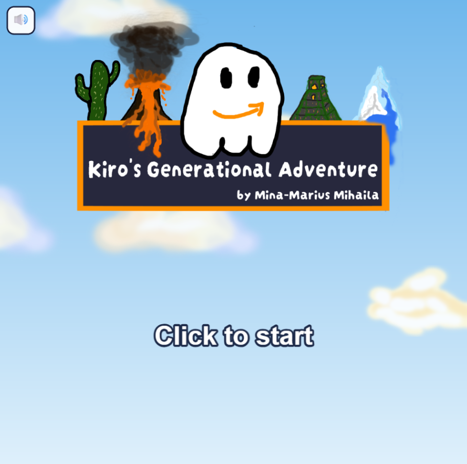

# Flappy Kiro

Kiro's Generational Adventure — a browser-based 2D side-scrolling arcade game
built with [Phaser 3](https://phaser.io/), [Vite](https://vite.dev/), and
TypeScript. Guide Kiro home across five worlds, each with its own movement
style, unlocking cosmetics and skills along the way.

## Example UI



## Getting Started

Follow these steps after cloning/pulling the repository to run the app
locally.

### Prerequisites

- **Node.js 20.19+ or 22.12+** (required by Vite 8). Check with `node -v`.
- **npm** (bundled with Node). Check with `npm -v`.

### 1. Install dependencies

From the project root:

```bash
npm install
```

This reads `package.json` / `package-lock.json` and installs Phaser plus the
dev tooling (Vite, TypeScript, Vitest) into `node_modules/`.

### 2. Run the dev server

```bash
npm run dev
```

Vite starts a local dev server with hot-reload and prints a URL (typically
<http://localhost:5173>). Open it in your browser to play. Click **"Click to
start"** on the title screen to begin.

### 3. Build for production (optional)

```bash
npm run build
```

Type-checks the project (`tsc --noEmit`) and bundles it into the `dist/`
folder. To preview that production build locally:

```bash
npm run preview
```

## Available scripts

| Command              | What it does                                        |
| -------------------- | --------------------------------------------------- |
| `npm run dev`        | Start the Vite dev server with hot-reload           |
| `npm run build`      | Type-check, then build the production bundle to `dist/` |
| `npm run preview`    | Serve the production build locally                  |
| `npm run typecheck`  | Run the TypeScript type-checker only                |
| `npm test`           | Run the test suite once (Vitest)                    |
| `npm run test:watch` | Run the tests in watch mode                         |

## Project layout

- `src/` — game source (TypeScript): entry point `main.ts`, game scenes and
  systems under `src/game/`
- `assets/` — game audio and sprites
- `img/` — screenshots and images
- `dist/` — production build output (generated by `npm run build`)
